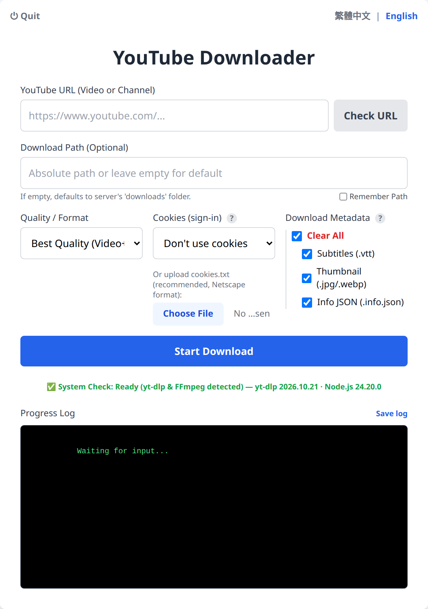

# YouTube Downloader Web Application

**English** | [繁體中文](README.zh-TW.md)

A lightweight, local web-based tool to download YouTube videos or entire channels with a simple UI. Built with Node.js (Express), Vite, TypeScript, and Tailwind CSS.

[Repository Link: https://github.com/yunyanliu261/YT_Batch_Download](https://github.com/yunyanliu261/YT_Batch_Download)

<p align="center">
  
</p>

## Features

- **Dual-Language UI**: Seamlessly switch between English and Traditional Chinese (繁體中文). Your preference is saved automatically.
- **Download Channels, Playlists or Single Videos**: Paste a YouTube URL and downloads are organized automatically:
  - Video or channel → `<download path>/<channel>/`
  - Playlist → `<download path>/<channel>/<playlist title>/`
- **Pre-Download Checks**: Built-in verification to check URL validity, display video counts, and ensure the target download path exists and is writable.
- **Smart Duplicate Prevention**: Automatically tracks downloaded videos using an archive file (`download_archive.txt`). If you restart a channel download, it instantly skips videos you already have. The archive is kept per channel, so a video found again in another playlist of the same channel is not downloaded twice.
- **Select Quality**: Choose from Best (default), 1080p, 720p, 480p, or Audio Only (MP3).
- **Granular Metadata Control**: Optionally download extra files alongside your video. You can select all or pick individually:
  - Subtitles (`.vtt`)
  - Thumbnails (saved as `.jpg` next to the video)
  - Info JSON (video description, tags, etc.)
- **Custom Download Path**: Specify exactly where files should be saved on your machine.
- **Real-time Progress**: Progress bars for the current file and the whole playlist/channel, plus the download log. Downloads can be cancelled at any time.
- **Download Logs**: Each download saves a log file in `<channel folder>/logs/`, and the "Save log" button saves the on-screen log as a `.txt` file. Attach these when reporting a problem.
- **Clear Error Explanations**: When a download finishes, a summary shows how many videos were downloaded, skipped or failed, and why (members-only, age-restricted, bot check, private, region-blocked, DRM). If signing in would help, the Cookies option is highlighted.
- **Rate Limit Protection**: When downloading a playlist or channel, the app waits a random 5–30 seconds before each video to avoid being blocked by YouTube. Single videos start immediately.
- **Always Up to Date**: The bundled `yt-dlp` is updated automatically every time the server starts.

## Prerequisites

To run this application, you must have the following installed on your system:

1.  [Node.js](https://nodejs.org/) v22 or higher recommended (v18 works for public videos). `yt-dlp` uses the same Node.js to solve YouTube's JavaScript challenges, which is required when downloading with cookies (members-only / age-restricted videos).
2.  **macOS / Linux only:** [Python 3.9+](https://www.python.org/downloads/) (`python3` must be on your PATH; the `yt-dlp` build for these systems runs on Python). Windows does not need Python.

`yt-dlp` and FFmpeg are downloaded automatically by `npm install` (via `youtube-dl-exec` and `ffmpeg-static`).

## Installation & Running (Windows)

1.  Clone or download this repository to your computer.
2.  Double-click **`YouTube Downloader.vbs`** in the project folder.
    - **First run** (or after an update that adds packages): a window shows the installation progress. It closes when done.
    - After that, the app starts **in the background without any window** and the page opens in your browser at `http://localhost:3000`.
    - If the app is already running, double-clicking just opens the page again.
    - If something goes wrong, a message box shows the error.
3.  **To stop the app**, press **"⏻ Quit"** at the top left of the page, or double-click `stop_app.bat` (useful when the page is already closed). Downloads in progress are stopped.

`start_app.bat` does the same with one visible "YouTube Downloader" window that shows the server messages, which is handy for troubleshooting. Close that window or press "Quit" to stop.

When the app runs in the background, its messages are written to `server\server.log`, and launcher messages to `launcher.log`.

## Installation & Running (Mac/Linux)

Run the start script from the project folder:

```bash
./start_app.sh
```

It installs missing dependencies, builds the page, starts the server and opens `http://localhost:3000` in your browser. Press `Ctrl+C`, or "Quit" on the page, to stop it.

To start things manually instead:

```bash
cd server && npm install && cd ..
cd client && npm install && npm run build && cd ..
cd server && node index.js
```

Then open `http://localhost:3000`.

## Usage Guide

1.  **Language Selection**: Use the toggle at the top right to select your preferred language.
2.  **System Check**: Upon opening the page, look for the "System Check" indicator at the bottom. It should say "Ready" and show the detected yt-dlp version. The server checks for yt-dlp updates every time it starts.
3.  **YouTube URL**: Paste the link to a video, a playlist or a channel main page.
4.  **Check URL**: Click this button *before* downloading. It will query YouTube and display the video title, uploader name, and how many videos will be downloaded (useful for channels).
5.  **Download Path**: (Optional) Enter an absolute path on your machine (e.g., `C:\Users\You\Downloads` or `/home/user/downloads`). If left empty, files will be saved in `server/downloads`. Tick "Remember Path" to keep it for next time.
6.  **Quality**: Select your desired resolution.
7.  **Cookies (sign-in)**: (Optional) Only needed for members-only or age-restricted videos. Upload a `cookies.txt` (recommended) or choose the browser you are signed in with.
8.  **Download Metadata**: Use the checkboxes to select extra files you want saved alongside the video. Hover over the `?` icon for more information.
9.  Click **Start Download**. The "Progress Log" will display real-time updates as `yt-dlp` processes your request.

## Troubleshooting

-   **Finding the log**: look in `<download path>/<channel>/logs/` for a file named after the date and time of the download, or press "Save log" next to the progress log. The log never contains your cookie contents.

-   **"Port 3000 is already in use"**: another program, or an older version of this app, is using port 3000. Close older versions' "YouTube Downloader Backend/Frontend" windows. If you cannot find them, run `netstat -ano | findstr ":3000"` (Windows) or `lsof -i :3000` (macOS/Linux) and stop the listed PID with `taskkill /PID <PID> /F` or `kill <PID>`. Then start the app again.
-   **Nothing happens / the page does not open** when using `YouTube Downloader.vbs`: run `start_app.bat` instead to see all messages, and check `server\server.log` and `launcher.log`.

-   **"Requested format is not available" only when cookies are used**, or age-restricted videos failing even though your account can play them: `yt-dlp` needs a JavaScript runtime for signed-in downloads. The app uses the Node.js it runs on, which must be v22 or newer; the system check shows the version. Update Node.js from [nodejs.org](https://nodejs.org/) and restart the app.
-   **Members-only or age-restricted videos** ("This video is not available", "Sign in to confirm your age"): these need a signed-in account. Members-only videos need an account that has joined the channel's membership; age-restricted videos need an age-verified account. Upload a `cookies.txt` exported from that account (see the [yt-dlp guide on exporting YouTube cookies](https://github.com/yt-dlp/yt-dlp/wiki/Extractors#exporting-youtube-cookies)) or choose the browser you are signed in with. Keep `cookies.txt` private: it works like your login.

-   **"System Check Failed"**: Run `npm install` again in the `server` folder so the yt-dlp binary is downloaded (on Windows, run `set YOUTUBE_DL_SKIP_PYTHON_CHECK=1` first if Python is not installed). On macOS/Linux, also make sure `python3` (3.9+) is installed.
-   **403 Forbidden / Sign in to confirm your age**: Some videos are age-restricted. You can bypass this by using the "Cookies (sign-in)" option in the UI to authenticate with your signed-in account.
-   **Files missing audio/video**: Ensure FFmpeg is available on your system so the tool can merge the best video and best audio streams together.
-   **"Requested format is not available"**: If you see this error (often on official music videos or premium content), it means the video is protected by DRM (Digital Rights Management). `yt-dlp` cannot download DRM-protected content.
-   **"Could not copy Chrome cookie database"**: If you selected Chrome in the "Cookies (sign-in)" dropdown and see this error, it means Chrome is currently running and has locked its cookie file. You must completely close Chrome (including background processes via the system tray or Task Manager) before attempting the download again, or choose another browser such as Firefox, or upload a `cookies.txt` instead.

## Tech Stack

-   **Backend**: Node.js, Express, `youtube-dl-exec` (wrapper for the powerful `yt-dlp` binary), `ffmpeg-static`.
-   **Frontend**: Vite, Vanilla TypeScript, Tailwind CSS.

## Security Notes

-   The backend only listens on `127.0.0.1:3000` and only accepts requests from the local frontend (`localhost` / `127.0.0.1`). Other websites and other machines on your network cannot use it.
-   Only `http://` and `https://` URLs are accepted, and the download path must be an absolute path.

## Development

-   Run the backend tests: `cd server && npm test`
-   Live-reload while editing the page: start the server (`cd server && node index.js`), then run `cd client && npm run dev` and open `http://localhost:5173`. Without the dev server, run `npm run build` in `client` after changes.
-   Set `SKIP_YTDLP_UPDATE=1` to skip the yt-dlp update check on server start.
