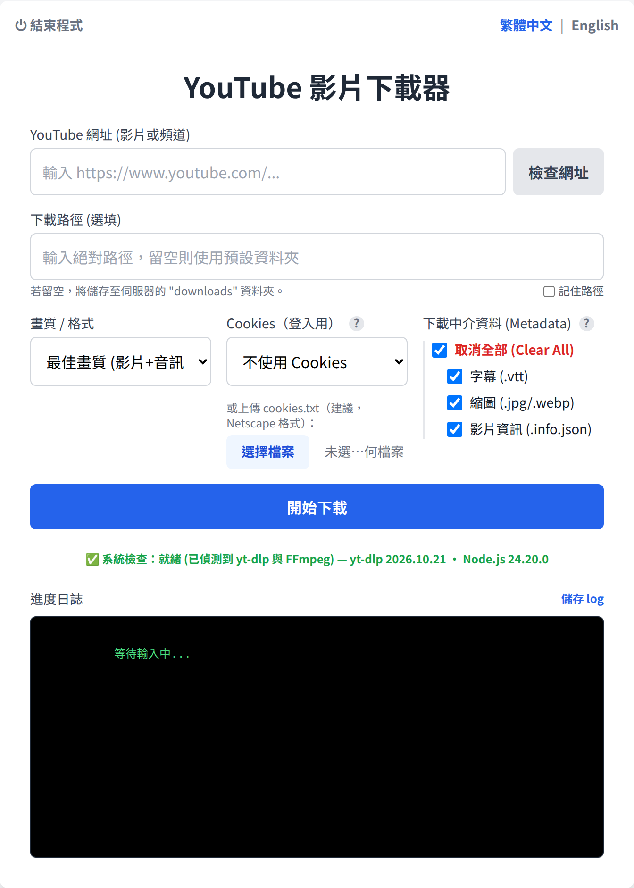

# YouTube 影片下載器（網頁版）

[English](README.md) | **繁體中文**

一個在本機執行的輕量網頁工具，用簡單的介面下載 YouTube 影片或整個頻道。使用 Node.js（Express）、Vite、TypeScript 與 Tailwind CSS 開發。

[專案網址：https://github.com/yunyanliu261/YT_Batch_Download](https://github.com/yunyanliu261/YT_Batch_Download)

<p align="center">
  
</p>

## 功能

- **雙語介面**：可隨時切換英文與繁體中文，選擇會自動記住。
- **下載頻道、播放清單或單一影片**：貼上 YouTube 網址後，檔案會自動依下列方式分類：
  - 影片或頻道 → `<下載路徑>/<頻道名稱>/`
  - 播放清單 → `<下載路徑>/<頻道名稱>/<播放清單名稱>/`
- **下載前檢查**：可先確認網址是否有效、顯示影片數量，並檢查下載路徑是否存在且可寫入。
- **自動避免重複下載**：用紀錄檔（`download_archive.txt`）記錄已下載的影片。重新下載同一個頻道時，已經有的影片會直接略過。紀錄檔以頻道為單位，所以同一頻道的影片即使出現在另一個播放清單，也不會重複下載。
- **選擇畫質**：最佳畫質（預設）、1080p、720p、480p，或僅音訊（MP3）。
- **自選中介資料（Metadata）**：可額外下載以下檔案，全選或個別勾選皆可：
  - 字幕（`.vtt`）
  - 縮圖（以 `.jpg` 儲存在影片旁）
  - 影片資訊 JSON（影片說明、標籤等）
- **自訂下載路徑**：指定檔案要存到電腦上的哪個位置。
- **即時進度**：顯示目前檔案與整個播放清單／頻道的進度條，以及下載日誌。下載途中可隨時取消。
- **下載日誌**：每次下載都會在 `<頻道資料夾>/logs/` 存一份日誌檔；按「儲存 log」也可以把畫面上的日誌存成 `.txt` 檔。回報問題時請附上這些檔案。
- **清楚的錯誤說明**：下載結束後會顯示摘要，列出成功、略過、失敗的影片數量與原因（會員限定、年齡限制、機器人驗證、私人影片、地區限制、DRM）。如果登入就能解決，會特別標示 Cookies 選項。
- **避免被限制下載**：下載播放清單或頻道時，每部影片開始前會隨機等待 5–30 秒，降低被 YouTube 封鎖的機會。單一影片會立即開始。
- **自動保持最新**：每次啟動伺服器時，內建的 `yt-dlp` 都會自動更新。

## 系統需求

執行本程式前，系統需安裝：

1.  [Node.js](https://nodejs.org/)，建議 v22 以上（只下載公開影片的話 v18 也可以）。`yt-dlp` 會用同一個 Node.js 處理 YouTube 的 JavaScript 驗證；使用 cookies 下載（會員限定、年齡限制影片）時一定需要。
2.  **僅 macOS / Linux：** [Python 3.9+](https://www.python.org/downloads/)（`python3` 必須在 PATH 中；這些系統上的 `yt-dlp` 需要 Python 執行）。Windows 不需要 Python。

`yt-dlp` 與 FFmpeg 會在執行 `npm install` 時自動下載（透過 `youtube-dl-exec` 與 `ffmpeg-static`）。

## 安裝與執行（Windows）

1.  將此專案 clone 或下載到電腦上。
2.  雙擊專案資料夾中的 **`YouTube Downloader.vbs`**。
    - **第一次執行**（或更新後需要安裝新套件時）：會出現一個視窗顯示安裝進度，完成後自動關閉。
    - 之後程式會**在背景啟動，不會出現任何視窗**，並用瀏覽器開啟 `http://localhost:3000`。
    - 如果程式已經在執行，再雙擊一次只會重新開啟頁面。
    - 啟動失敗時，會跳出訊息視窗顯示錯誤內容。
3.  **要關閉程式時**，按頁面左上角的「**⏻ 結束程式**」，或雙擊 `stop_app.bat`（頁面已經關掉時適用）。正在進行的下載會停止。

`start_app.bat` 的功能相同，但會保留一個「YouTube Downloader」視窗顯示伺服器訊息，適合用來排查問題。關掉該視窗或按「結束程式」即可停止。

程式在背景執行時，伺服器訊息會寫到 `server\server.log`，啟動過程的訊息寫到 `launcher.log`。

## 安裝與執行（Mac / Linux）

在專案資料夾中執行啟動腳本：

```bash
./start_app.sh
```

它會安裝缺少的套件、建置頁面、啟動伺服器，並用瀏覽器開啟 `http://localhost:3000`。按 `Ctrl+C` 或頁面上的「結束程式」即可停止。

如果要手動啟動：

```bash
cd server && npm install && cd ..
cd client && npm install && npm run build && cd ..
cd server && node index.js
```

然後開啟 `http://localhost:3000`。

## 使用說明

1.  **切換語言**：用右上角的切換鈕選擇語言。
2.  **系統檢查**：開啟頁面後，留意下方的「系統檢查」狀態。正常時會顯示「就緒」與偵測到的 yt-dlp 版本。伺服器每次啟動都會檢查 yt-dlp 是否有更新。
3.  **YouTube 網址**：貼上影片、播放清單或頻道首頁的網址。
4.  **檢查網址**：下載*前*先按這個按鈕。它會向 YouTube 查詢並顯示影片標題、上傳者，以及將下載的影片數量（下載頻道時特別有用）。
5.  **下載路徑**：（選填）輸入電腦上的絕對路徑（例如 `C:\Users\You\Downloads` 或 `/home/user/downloads`）。留空時會存到 `server/downloads`。勾選「記住路徑」可保留到下次使用。
6.  **畫質 / 格式**：選擇想要的解析度。
7.  **Cookies（登入用）**：（選填）只有會員限定或年齡限制影片需要。可上傳 `cookies.txt`（建議），或選擇已登入 YouTube 的瀏覽器。
8.  **下載中介資料（Metadata）**：勾選要和影片一起儲存的額外檔案。滑鼠移到 `?` 圖示上可看說明。
9.  按 **開始下載**。「進度日誌」會即時顯示 `yt-dlp` 的處理進度。

## 疑難排解

-   **找不到日誌檔**：到 `<下載路徑>/<頻道名稱>/logs/` 找以下載日期時間命名的檔案，或按進度日誌旁的「儲存 log」。日誌不會包含你的 cookie 內容。

-   **「連接埠 3000 已被佔用」**：其他程式或本程式的舊版本正在使用連接埠 3000。請關掉舊版本的「YouTube Downloader Backend/Frontend」視窗。如果找不到這些視窗，執行 `netstat -ano | findstr ":3000"`（Windows）或 `lsof -i :3000`（macOS/Linux），再用 `taskkill /PID <PID> /F` 或 `kill <PID>` 結束列出的 PID，然後重新啟動程式。
-   **用 `YouTube Downloader.vbs` 啟動後沒有反應 / 頁面沒有開啟**：改用 `start_app.bat` 啟動以查看完整訊息，並檢查 `server\server.log` 與 `launcher.log`。

-   **只有使用 cookies 時出現「Requested format is not available」**，或帳號明明能播放、年齡限制影片卻下載失敗：登入後的下載需要 JavaScript 執行環境。本程式使用執行它的 Node.js，版本必須是 v22 以上；系統檢查會顯示目前版本。請到 [nodejs.org](https://nodejs.org/) 更新 Node.js 後重新啟動程式。
-   **會員限定或年齡限制影片**（「This video is not available」、「Sign in to confirm your age」）：需要登入帳號。會員限定影片需要已加入該頻道會員的帳號；年齡限制影片需要通過年齡驗證的帳號。請上傳從該帳號匯出的 `cookies.txt`（參考 [yt-dlp 匯出 YouTube cookies 的說明](https://github.com/yt-dlp/yt-dlp/wiki/Extractors#exporting-youtube-cookies)），或選擇已登入該帳號的瀏覽器。請妥善保管 `cookies.txt`，它的作用等同你的登入狀態。

-   **「系統檢查失敗」**：在 `server` 資料夾重新執行 `npm install`，讓 yt-dlp 主程式下載完成（Windows 若沒有安裝 Python，請先執行 `set YOUTUBE_DL_SKIP_PYTHON_CHECK=1`）。macOS/Linux 另需確認已安裝 `python3`（3.9 以上）。
-   **403 Forbidden / Sign in to confirm your age**：部分影片有年齡限制。可以在介面的「Cookies（登入用）」選項使用已登入的帳號來下載。
-   **檔案沒有聲音或沒有畫面**：請確認系統上有 FFmpeg，程式才能把最佳畫質的影像與音訊合併。
-   **「Requested format is not available」**：如果看到這個錯誤（常見於官方音樂影片或付費內容），代表影片受 DRM（數位版權管理）保護，`yt-dlp` 無法下載受 DRM 保護的內容。
-   **「Could not copy Chrome cookie database」**：在「Cookies（登入用）」選擇 Chrome 時出現這個錯誤，代表 Chrome 正在執行並鎖住了它的 cookie 檔。請完全關閉 Chrome（包含系統匣或工作管理員中的背景程序）後再試，或改用 Firefox 等其他瀏覽器，也可以上傳 `cookies.txt`。

## 使用技術

-   **後端**：Node.js、Express、`youtube-dl-exec`（`yt-dlp` 的包裝套件）、`ffmpeg-static`。
-   **前端**：Vite、原生 TypeScript、Tailwind CSS。

## 安全性說明

-   後端只監聽 `127.0.0.1:3000`，也只接受本機前端（`localhost` / `127.0.0.1`）的請求。其他網站與區域網路上的其他電腦都無法使用。
-   只接受 `http://` 與 `https://` 網址，下載路徑必須是絕對路徑。

## 開發

-   執行後端測試：`cd server && npm test`
-   修改頁面時即時預覽：先啟動伺服器（`cd server && node index.js`），再執行 `cd client && npm run dev`，開啟 `http://localhost:5173`。若沒有使用開發伺服器，修改後請在 `client` 執行 `npm run build`。
-   設定 `SKIP_YTDLP_UPDATE=1` 可在啟動伺服器時略過 yt-dlp 更新檢查。
